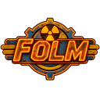

<p align="center"></p>

# Making mods on Linux with FOLM

A short guide for anyone who wants to **make** Fallout: New Vegas mods on Linux —
new weapons, armor, places, quests, fixes — using the GECK, with FOLM doing the
Linux-specific setup for you.

You don't need to know anything about Wine or Proton.

---

## 1. One-time setup

1. **Install the game in Steam** and launch it once (so Steam creates its settings).
2. **Install FOLM** and set it up (see the main [README](README.md)).
3. **Install xNVSE** through FOLM, like any other mod. It lets the GECK use script-extender
   functions, and FOLM uses it to start the GECK correctly.
4. **Install the GECK — from Steam.**
   In your Steam **Library**, change the filter from *Games* to **Tools**, find
   **"Fallout New Vegas: Garden of Eden Creation Kit"** and install it. It's free, and it
   goes straight into your game folder, which is where FOLM looks for it.

That's it. FOLM takes care of the rest the first time you open the GECK, including
the setting that lets the GECK load more than one master file (needed for any mod that
uses a DLC or another mod's ESM).

---

## 2. Make a new mod

1. In FOLM, pick the **profile** you want to build against (the mods the GECK should see).
2. Click **🛠 GECK** → choose **"A new mod"**.
3. Build your mod in the GECK. **File → Save** like normal (e.g. `MyMod.esp`).
4. **Close the GECK.**
5. FOLM shows what you saved and asks for a name → type one → done.

Your mod is now a normal FOLM mod in the **Our mods** section: enabled, deployed,
and sorted with LOOT like everything else. Click **▶ Play** to try it.

*Command line:* `folm.py geck`, then `folm.py keep "My Mod"`.

---

## 3. Keep working on a mod

1. Click **🛠 GECK** → choose **"Edit: My Mod"**.
2. Make your changes, save, close the GECK.
3. FOLM puts the changes straight back into that mod.

*Command line:* `folm.py geck --edit "My Mod"`

---

## 4. Good habits (these save a lot of pain)

- **Never save over the game's own files** (`FalloutNV.esm`, DLC `.esm`s). Always save your own `.esp`.
- **Use lowercase folder names** for your textures and meshes (`textures/mymod/…`).
  Windows ignores letter case; Linux doesn't. FOLM fixes mismatches when it deploys,
  but players using other tools won't have that safety net.
- **Close other apps** while the GECK is open on a low-RAM PC — it's hungry.
- **Use profiles.** Make a "Modding" profile with just the base game + what your mod
  needs, so testing isn't affected by your playthrough's mods (and the other way round).
- **Check conflicts** in FOLM's **Conflicts** tab, and LOOT's notes in the **Plugins** tab,
  before you release.

---

## 5. Sharing your mod

Your mod's files live in FOLM's mods folder:

```
~/Games/FOLM/courier/mods/<Your Mod Name>/
```

Zip the **contents** of that folder (not the folder itself) and upload it. Players on
any OS and any mod manager can install it. Only share your **own** work — if you used
other people's assets, you need their permission.

---

## If something goes wrong

| Problem | Fix |
|---|---|
| "GECK isn't installed" | Install it from Steam → Library → **Tools** (see step 1.4) |
| The GECK window is blank or tiny | Give it a few seconds — the first start under Proton is slow |
| The GECK says it can't load multiple masters | Open it once through FOLM; FOLM adds the setting automatically |
| Nothing was collected after closing | You probably didn't save, or saved over an existing file in edit mode — check the **Log** tab |
| The PC freezes on a low-RAM machine | Close browsers/chat apps first; consider installing `earlyoom` |

Questions or broken mods: add them to [docs/compatibility.md](docs/compatibility.md)
so the next modder doesn't hit the same wall.
