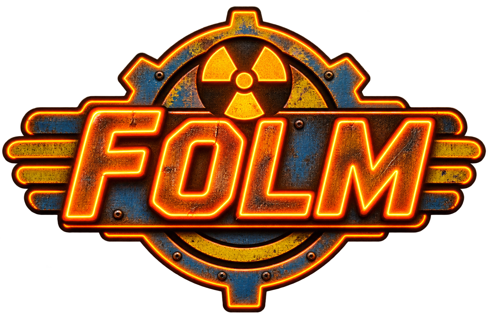

<p align="center"></p>

# The FOLM Project

> Unofficial fan-made tools. Not affiliated with or endorsed by Bethesda Softworks.

## Mission

**Linux players get the Windows modding experience: any mod, installed in a
click, working the first time.**

Other Linux mod managers handle the common cases. We focus on **all** mods,
including the old, odd and broken-installer ones that other tools skip.

## Editions

| Edition | For | Notes |
|---|---|---|
| **Courier** | Fallout: New Vegas, with **optional** Tale of Two Wastelands (TTW) support | xNVSE, 4GB Patcher, GECK + GECK Extender |
| **Wanderer** | Fallout 3 GOTY on its own | FOSE, FO3 memory patch, FO3 GECK, Windows Live leftovers |

### TTW is optional

FOLM is a mod manager for New Vegas and Fallout 3 first. **TTW support is an
extra for players who choose to use TTW**: it helps install TTW on Linux and
loads it like any other mod. Nothing in FOLM requires TTW. Plain New Vegas and
plain Fallout 3 are fully supported on their own.

TTW itself is the TTW team's work and is downloaded by the player from TTW's
official page. FOLM never bundles or re-hosts it.

### FOLM's own Fallout 3 → New Vegas mod converter

FOLM includes **its own converter** for bringing Fallout 3 mods to the New Vegas
engine, written from scratch for Linux. It does **not** use TTW's conversion
package, xEdit scripts or databases; everything it needs is built from the
player's own game files. Two targets:

- **→ TTW:** for players using TTW, so FO3 mods work in the Capital Wasteland inside New Vegas.
- **→ plain New Vegas:** brings Fallout 3 item mods into the Mojave without TTW. See the scope below.

> ### ⚠️ <ins>What the plain New Vegas converter covers</ins>
>
> **✅ Covered — Fallout 3 mods that add:**
> - **Gear**
> - **Weapons**
> - **Items**
> - **Clothes**
> - **Armor**
> - **Perks**
>
> **❌ <ins>NOT covered</ins> — Fallout 3 mods that add or change:**
> - **Quests**
> - **Player homes**
> - **Companions**
> - **Enemies / creatures / NPCs**
> - **New locations, cells or worldspaces**
>
> ***These depend on Fallout 3's world, so they can't be moved into the Mojave.*** To use
> them, play **TTW** and use the **→ TTW** target instead. If you try to convert one of
> these for plain New Vegas, FOLM's report will tell you up front.

It automates the mechanical parts, then gives a clear checklist for what needs a human in GECK.
Converting someone's mod, and especially sharing the result, needs the original author's
permission. Details: [docs/fo3-converter.md](docs/fo3-converter.md).

Both editions share one engine (`folm_core`). Each edition is a thin game layer
(`games/<edition>/game.json` plus game-specific setup), so a fix in the core
helps both, and adding another game later is just a new layer.

```
folm_core/          shared engine: detect, install, case-fix, deploy, load order
games/courier/      New Vegas / TTW layer
games/wanderer/     Fallout 3 layer
mods/               mods we make (restore, flesh out, update, patch, add)
NOTES.md            running setup log
backups/            anything we move out of a game folder (never deleted)
```

## What "Windows experience" means here

- Pick a mod file, and it installs. No manual folder surgery, no Wine knowledge needed.
- Your mods can live anywhere: file picker / drag and drop, any number of **library folders** (scanned with subfolders, other drives too), and a download folder you choose.
- Old FOMM-era script installers and `.exe` installers work too.
- Case-sensitivity problems (`Textures/` vs `textures/`) never happen.
- Script extender, memory patch, GECK and xEdit just work under Proton.
- Every mod is uninstallable and every change is reversible.
- Anything that fails goes on a public compatibility list and gets fixed.

## How it works

```
pick mod file → DETECT type → INSTALL to its own staging folder (case-fixed)
             → DEPLOY (link into Data, reversible) → LOAD ORDER → LAUNCH via script extender
```

| Mod type | How it's handled |
|---|---|
| Plain Data folder / loose files | Straight install |
| FOMOD with XML installer | Our own native installer |
| BAIN (numbered option folders) | Option picker |
| Root-level files (script extender plugins, DLLs) | Placed next to the game .exe |
| FOMOD/FOMM with C# script | Legacy script engine (reimplemented FOMM functions) |
| `.exe` installer | Run in a separate Wine sandbox against a decoy game folder; record what it changed and turn that into a normal mod |

## Making mods

Mod makers: FOLM opens the GECK with your mods loaded and turns what you save into a managed mod. See **[Making mods on Linux](MODDING-ON-LINUX.md)**.

## Archive invalidation

On by default (**⚙ Settings** in the app). On deploy FOLM redates the game's archives and writes
`bInvalidateOlderFiles=1` and `SInvalidationFile=` under `[Archive]` — into `FalloutCustom.ini` when JIP LN
is installed, otherwise into the game's `Fallout.ini` (backed up first). Undeploy restores the exact previous
values. No dummy archive needed.

## Recommended mods

For a smooth game on Linux, start with the engine and stability mods in
**[docs/recommended-mods.md](docs/recommended-mods.md)**: xNVSE, the 4GB Patcher, JIP LN, JohnnyGuitar,
ShowOff, NVTF, lStewieAl's Tweaks and Engine Optimizations, the lag and save-bloat fixes, Mod Limit Fix,
kNVSE, UIO, a crash logger and YUP (YUPTTW for TTW). Fallout 3 has its own list (FOSE, Anniversary
Patcher, Command Extender, High FPS Physics Fix…). The page also covers the Linux-only part (FPS cap,
windowed mode, low RAM) and what to avoid. Lists follow ModdingLinked's community guides.

## Saves, FPS cap and pre-Play checks

- **Save safety:** FOLM reads the plugin list stored in each save. Untick a mod your recent saves use and it
  warns you first (removing mods mid-playthrough breaks quests and scripts). Deploy and Play warn too.
- **Per-profile saves** (on by default): each profile keeps its saves in `Saves/<profile>/`, so a test setup
  never mixes with your playthrough. The Default profile keeps the normal `Saves` folder.
- **FPS cap** (default 120): above ~120 FPS these engines' physics break (bouncing NPCs, sped-up game).
  NVTF and Stewie's Tweaks don't include a limiter, so FOLM sets one in DXVK, the Direct3D layer Proton uses:
  `d3d9.maxFrameRate` in the game folder's `dxvk.conf`. Any existing `dxvk.conf` is backed up and restored on undeploy.
- **Before ▶ Play** FOLM checks: mods deployed, Steam running, the exe still 4GB-patched (verifying files in
  Steam undoes it), xNVSE present when NVSE plugins are, missing masters, LOOT errors, saves that need
  plugins that are now off, and V-Sync off with no FPS cap. Problems show in one box: Play anyway or Cancel.

All of these are in the app's **⚙ Settings** menu; every change is undone exactly on undeploy.

## Load order & LOOT

FOLM keeps two separate orders:

- **Mod order** (the left-hand list): decides which mod wins when two mods ship the same file.
  Lower in the list wins. **Sort mods** arranges it into sections without changing any winner.
- **Plugin load order** (the Plugins tab): the order the game loads `.esm`/`.esp` files.
  FOLM sorts it automatically every time you deploy, using:
  1. **Hard rules:** a plugin always loads after its masters, ESMs before ESPs, vanilla files first.
  2. **LOOT's rules:** LOOT's community masterlist (groups, "load after" rules), downloaded from
     LOOT's official GitHub and refreshed weekly. With TTW, for example, LOOT places the courier
     packs (Caravan, Classic, Mercenary, Tribal) after the Fallout 3 DLC and before
     `TaleOfTwoWastelands.esm`, which is TTW's official order.
  3. **Your own order** only breaks ties.

  Offline? FOLM sorts with the hard rules and its built-in vanilla/TTW order instead.

**LOOT messages** appear at the bottom of the Plugins tab, in the status bar, and in `folm.py loot`:

| Mark | Meaning |
|---|---|
| ℹ (blue) | A note: version checks ("Your New Vegas Script Extender is up-to-date"), links to a mod's docs. Nothing to fix |
| ⚠ (orange) | A warning: e.g. a plugin needs cleaning, or an outdated file |
| ✖ (red) | An error: e.g. a required mod is missing or two mods are incompatible. Fix before playing |

## Compatibility

Problems other mod managers have, and how FOLM handles each: [docs/known-issues.md](docs/known-issues.md).

Every mod tested with FOLM, and what happened: [docs/compatibility.md](docs/compatibility.md).

## Our mods

Besides the managers, we make mods that **restore, flesh out, update, patch
and add** to the games. They're all original work, and they double as test
cases for the managers. See [mods/README.md](mods/README.md).

## Roadmap

| # | Piece | Status |
|---|---|---|
| 0 | `nvcase`: case-collision checker and fixer | ✅ working |
| 1 | `detect`: identify what kind of mod a file is (exe / TTW installer / FOMOD XML / FOMOD C# / BAIN / Data / game-root), warn on case collisions | ✅ working |
| 2 | `folm.py` v0.1: staging, hard-link deployment with case fixing, conflict order, game-file backups, load order via plugin timestamps + plugins.txt, exact undo. Tested on a fake game folder | ✅ working — next: real TTW + YUPTTW |
| 2b | Organizer: **sections + Sort mods** (Base game & TTW → Utilities & engine → Bug fixes → UI & menus → Content → Gameplay → Visuals → Our mods; never changes who wins a file conflict; patches stay with what they patch), **profiles** (separate setups sharing one mod library, each with its own Overwrite), **conflict viewer**, **overwrite catcher** (new/changed files in the game folder → Overwrite mod), notes and tags ✅. Still to do: separators/categories, search/filter, update checks | ✅ core done |
| 2d | **LOOT** (`folm_core/loot.py`): native reader for LOOT's public-domain masterlist — groups, load-after/requirement rules, conditional messages, missing requirements, incompatibilities, dirty plugins; plugin sorting uses it; messages in the CLI (`folm.py loot`) and the app's Plugins tab. Falls back to master-only sorting offline | ✅ |
| 2c | **FO3 → TTW converter**, Linux-native (see [docs/fo3-converter.md](docs/fo3-converter.md)): plugin reader/writer ✅, `convert-check` report ✅; masters + FormID renumbering, FOLM's own remap table (built from the player's FO3 + TTW files, no TTW tools), guided GECK pass | in progress |
| 3 | **XML FOMOD installer** (`folm_core/fomod.py`): steps, conditional steps, all group types, setup-dependent option types, flags, conditional files, priorities, any text encoding; choices saved per mod and replayable. App wizard with descriptions + preview images; terminal prompts or `--auto` on the CLI ✅. `.exe` sandbox installer: proven by hand with TTW, still to automate | ✅ FOMOD done |
| 4 | Script extender / memory patch / GECK / xEdit setup under Proton (per edition) | planned |
| 4b | One-click dependencies: "Download & Install" from the official source, verify, install, confirm it works, removable. Nexus "Mod Manager Download" (nxm://) handler; optional Premium API with the player's own account. "Open official page" as a fallback | planned |
| 4c | ✅ **Crash reports** (`folm_core/crash.py`): when a game launched with ▶ Play exits unexpectedly (or the Crash Logger wrote something), FOLM builds one report: crash logger + xNVSE + game error logs, mod list, load order, LOOT warnings, profile, Proton/RAM/swap/GPU; plain-language diagnosis where possible (missing master, failed NVSE plugin, out of memory, known LOOT issue); one-click save to share. FOLM's own errors are reported the same way. Local only, never uploaded; usernames and home paths redacted. `folm.py play` / `folm.py crash-report` | ✅ first version |
| 5 | **The app** (`folm_gui.py`, Qt 6): edition + profile switcher, Deploy / Undeploy / Play, mod list with checkboxes, drag-to-reorder and conflict marks, tabs for Plugins (load order + masters + problems), Conflicts, Overwrite, Library (scan folders, double-click to install), Notes/tags, Log; drag a mod file onto the window to install. Same engine as the command line (`folm_core/manager.py`) | ✅ first version |
| 6 | **Legacy FOMM C# installers** (`folm_core/legacy.py` + `fomm_shim/FommShim.cs`): compiled with Mono against FOLM's own FOMM shim, run in a bubblewrap sandbox, the mod's own installer window shown natively. First success: Project Nevada 2.5. See [docs/legacy-installers.md](docs/legacy-installers.md) | ✅ first version |

Our own playthrough (TTW + our wasteland-select menu, fixes and QoL) doubles
as the test lab: every problem we hit becomes a fix in the tool.

## The app

```bash
./run-folm.sh          # first run: creates nothing outside ~/Games/FOLM and the project folder
./make-shortcut.sh     # add FOLM to your app menu (add --desktop for a desktop icon too)
```

The FOLM logo and icons in `assets/` are the project's own artwork. FOLM doesn't ship any Bethesda icons or artwork.

First-time setup inside the project: `uv venv .venv && uv pip install --python .venv/bin/python -r requirements.txt`

## folm.py (command line)

```bash
python3 folm.py init                          # finds New Vegas and its Proton prefix
python3 folm.py add "Tale of Two Wastelands"  # register a mod already in the mods folder
python3 folm.py install SomeMod.7z            # stage a mod from an archive (Data / game-root types for now)
python3 folm.py list                          # mods in order; later mods win file conflicts
python3 folm.py move "Some Mod" --after "Other Mod"
python3 folm.py disable "Some Mod"
python3 folm.py deploy                        # hard-link mods into the game + set the load order
python3 folm.py order                         # show the plugin load order and any missing masters
python3 folm.py undeploy                      # put the game folder back exactly as it was
python3 folm.py conflicts                     # which mods overwrite which files, and who wins
python3 folm.py catch                         # move files the game/tools created into this profile's Overwrite
python3 folm.py profile create "Vanilla"      # profiles: create / switch / list / delete (--copy-from P)
python3 folm.py note NAME "text"; python3 folm.py tag NAME fixes ttw
python3 folm.py sort --preview              # arrange mods into sections (then 'sort' to apply)
python3 folm.py category NAME "Visuals"      # override a mod's section ('auto' to reset)
python3 folm.py convert-check SomeFO3Mod.esp  # what converting a Fallout 3 plugin to TTW needs
python3 folm.py settings                      # e.g. archive invalidation (app: ⚙ Settings menu)
python3 folm.py set archive-invalidation on   # loose mod files override the game's archives (default on)
python3 folm.py set fps-cap 120                # or off; written to dxvk.conf on deploy
python3 folm.py set profile-saves on          # each profile keeps its own saves
python3 folm.py preflight                     # the pre-Play checks (play runs them too; --force to skip)
```

Add `--edition wanderer` for Fallout 3. Profiles, staged mods and backups live in `~/Games/FOLM` (override with `FOLM_HOME`).

- **Hard links:** mods appear in the game folder without using extra disk space; deploy/undeploy is near-instant.
- **Case fixing:** a mod's `textures/` merges into the game's existing `Textures/` instead of creating a twin.
- **Load order:** plugins are sorted so masters always load first (read from each plugin's header), then the
  file timestamps are set (that's how these engines order plugins) and `plugins.txt` is written.
- **Safe:** game files a mod overrides are backed up; undeploy restores files, sizes, contents and timestamps exactly.

## detect

```bash
python3 folm_core/detect.py SomeMod.7z AnotherMod.zip   # files anywhere on disk; add --json for machine-readable output
python3 folm_core/detect.py --scan ~/Mods --scan /media/usb/Fallout   # search folders + all subfolders
```

Reads the archive's file list only (via `7z`; zip, 7z and rar supported), never extracts.

## nvcase

Requires Python 3.8+. No other dependencies.

```bash
# Report problems (changes nothing)
python3 folm_core/nvcase.py "/path/to/Fallout New Vegas/Data"

# Merge case-duplicate folders and write an undo log
python3 folm_core/nvcase.py "/path/to/Data" --fix

# Also rename everything to lowercase, so future mods can't collide
python3 folm_core/nvcase.py "/path/to/Data" --fix --lowercase

# Undo a previous --fix run
python3 folm_core/nvcase.py --undo nvcase-undo-YYYYmmdd-HHMMSS.json
```

Safety: report-only by default, never overwrites (collisions are reported for
you to decide), and every move is recorded so `--undo` reverses it.

## Credits

FOLM stands on the shoulders of a community that has kept these games alive for over fifteen years.

- **The Tale of Two Wastelands team** — the project that inspired FOLM. TTW showed what a
  dedicated community can build: two games joined into one. FOLM is our attempt to carry that
  spirit to another operating system, so more people can experience what the modding community
  has created. FOLM supports TTW, but TTW is entirely their work: players download it from
  TTW's official page, and FOLM never bundles or re-hosts it.
- **LOOT** ([loot.github.io](https://loot.github.io)) — the load-order standard for years. FOLM reads
  LOOT's public-domain masterlists, maintained by the LOOT team and community, from LOOT's
  official GitHub, to sort plugins and warn about missing requirements, incompatibilities and
  dirty plugins.
- **ModdingLinked** — authors of *The Best of Times* (TTW) and *Viva New Vegas* guides. FOLM's
  section order and the TTW settings it writes follow their guides.
- **xNVSE team** and the authors of **JIP LN, JohnnyGuitar, ShowOff, lStewieAl's Tweaks, UIO,
  MCM, YUP/YUPTTW**, the **4GB patchers**, and every mod author whose work FOLM installs.
- **Bethesda Softworks and Obsidian Entertainment** for the games themselves.

FOLM is an unofficial fan project. Each mod belongs to its authors and keeps its own license;
FOLM installs mods the player downloaded and doesn't redistribute anyone's work.
